# Humanize (Adversarial Review Loop)

## Overview

A persistent adversarial loop between two agents and one human:

- an **Implementer** that produces the artifact,
- a **Challenger** that critiques it and judges it against an agreed brief,
- **you**, the orchestrator, who negotiates the brief with the user, relays messages, keeps
  the item ledger, and escalates anything the two agents cannot settle.

**Core principle:** the challenger IS the quality gate — nothing returns to the user until the
challenger says PASS *and* every acceptance criterion is met. But the implementer is not a
doormat: it may rebut a critique with evidence, and the challenger must either concede or argue
back. A disagreement neither side can settle is the user's call, never yours.

Each role runs on the harness configured for it in `harness.json`. The default keeps the
implementer native and the challenger on a **different harness**, because a challenger raised in
the implementer's own harness shares its tool surface, context management, and prompt scaffolding
— different context alone does not decorrelate it.

## When to Use

- Complex, multi-faceted tasks where a second pair of eyes catches real issues
- Tasks where correctness matters: algorithms, parsers, data pipelines, auth logic
- Design + implementation tasks where blind spots are likely

**When NOT to use:**
- Trivial one-liners or single-function tasks with no room for error
- Tasks the user needs immediately (this is slow — 2+ rounds minimum)
- Purely conversational/informational requests

## Harness Configuration

Read `harness.json`, next to this skill, before anything else. It decides which harness executes
each role:

```json
{
  "implementer": { "harness": "native" },
  "challenger": { "harness": "opencode", "model": "opencode/claude-fable-5-1" }
}
```

| Field | Meaning |
|-------|---------|
| `harness` | `native` (this harness's own agent tool) or one of `dsh`, `claude-code`, `codex`, `opencode` |
| `model` | Optional. Forwarded through the harness's own model flag. Omit to inherit that harness's default route |
| `path` | Optional. Binary path for a harness that is installed outside `PATH` |

The shipped config leaves `model` unset, so each harness inherits its own default route. Set it
when you also want a different model family for the challenger — the id is harness-specific
(`opencode models` lists opencode's, `claude --model` and `codex -m` take theirs).

Rules:

- Missing or unreadable config → both roles run native, with a warning. A role you omit runs native.
- Unknown harness name → stop; the error lists the valid names.
- A role whose harness is the one you are running in → run it natively. Launching a subprocess of
  yourself buys no decorrelation.
- A configured harness that is missing or unauthenticated → stop and report. **Never fall back to
  native.** Silently collapsing back to one harness is the exact failure this configuration
  exists to prevent.

| Harness | Persistence | Final message comes from |
|---------|-------------|--------------------------|
| `native` | session — this harness's own agent tool | agent result |
| `dsh` | session — `--json` records the session id on round 1, `--session-id` adopts it later | JSON `final` event |
| `claude-code` | session — `--session-id` then `--resume` | JSON `result` |
| `codex` | session — `codex exec resume` | the `-o` last-message file |
| `opencode` | session — `-s <sessionID>` | JSON event stream |

`scripts/run_role.py` owns every harness flag, session id, and permission default. Do not compose
harness commands yourself; see [Runner Cheat Sheet](#runner-cheat-sheet). Every `scripts/…` and
`prompts/…` path below is relative to **this skill's directory**, not to the user's workspace —
resolve it before running bash.

### Session keep-alive (default for every role)

Each role keeps **one session for the whole loop**. Round 1 creates it; every later round resumes
it — on every harness, `dsh` included. The session carries the role's own reasoning record, so a
resumed round sends only the delta: the compact criteria list, the latest feedback or artifact
pointer. A fresh session mid-loop (only via `--reset-session`, or after a lost session) discards
that record and forces the full-payload prompt — resume unless the session is actually lost.

Honest accounting: the resumed harness still replays session history to the model internally
(usually cached), so what shrinks is the prompt *you* compose and re-send each round, plus the
risk of losing the debate record. A `dsh` session is additionally bound to the `--cwd` it was
created in — pass the same `--cwd` on every round; the runner refuses a moved resume (exit 2)
rather than letting the harness fail late.

### Communication method ({{COMMS}})

The two roles talk either **directly** (team mode) or **through you** (relay). Resolve which in
Step 0, and insert the matching block into each role prompt's `{{COMMS}}` slot in Step 2.

- A role runs **natively** when its `harness` is `native` or equals the harness you are running
  in (the rule above). Otherwise it is **bridged** — launched by `run_role.py` as its own process.
- **Team mode** applies only when *both* roles resolve natively *and* the harness you are running
  in is team-capable. A bridged role can never be team mode: two `run_role.py` subprocesses cannot
  reach each other.
- **Relay mode** is everything else — a bridged role, a mixed config, or a native pair on a
  harness without team tools.
- Team-capable, as shipped, is every harness in the `HARNESSES` registry (`dsh`, `codex`,
  `claude-code`, `opencode`); shrink that set if one turns out to lack agent-team tools.

In team mode both roles are teammates on the running harness, messaging each other directly with
the harness's agent-team tools (`spawn_teammate` + `send_message`) over a shared working
directory; the artifact travels **by path**, never inlined into your context. You still own the
brief, the ledger, the round and dispute caps, the PASS guard, arbitration, and every user
interaction. The challenger's read-only stance rests on its role prompt and your review, since
teammates share one tool surface.

Tradeoff, stated plainly: both roles share one harness's tool surface and scaffolding — the
blind-spot correlation the split-harness default exists to avoid. Team mode buys persistent
sessions and a direct, low-overhead debate; take it only when the config already puts both roles
natively on a team-capable harness, and keep the split-harness default otherwise.

**The `{{COMMS}}` blocks.** Copy the matching one into each role prompt verbatim.

*implementer / team*

```markdown
## How you communicate

You and the challenger are teammates on this harness, sharing one working directory. Send your
disputes and escalations to the challenger **directly** with this harness's agent-team tools
(`send_message`) — never route the debate through the orchestrator. The challenger messages its
FEEDBACK and DISPUTE RESPONSES straight back to you. The orchestrator still owns the brief, the
ledger, the caps, and every user interaction: send it the artifact path and a one-line round
summary, not your full exchange.
```

*implementer / relay*

```markdown
## How you communicate

You do not talk to the challenger directly. Everything you send goes to the orchestrator, which
relays it. Address the orchestrator as "you"; it delivers the challenger's FEEDBACK and DISPUTE
RESPONSES back to you, and carries your disputes to the challenger.
```

*challenger / team*

```markdown
## How you communicate

You and the implementer are teammates on this harness, sharing one working directory. Deliver
your FEEDBACK and DISPUTE RESPONSES to the implementer **directly** with this harness's
agent-team tools (`send_message`) — never route them through the orchestrator — and the
implementer's disputes reach you the same way. Send the orchestrator only your full structured
verdict; it still owns the brief, the ledger, the caps, and every user interaction.
```

*challenger / relay*

```markdown
## How you communicate

You do not talk to the implementer directly. Send your full verdict to the orchestrator, which
relays your FEEDBACK and DISPUTE RESPONSES to the implementer; the implementer's disputes reach
you the same way.
```

## Flow

1. Resolve both roles from `harness.json` and preflight their harnesses (Step 0)
2. Negotiate the brief with the user and write `BRIEF.md` (Step 1)
3. Run the implementer → challenger loop, relaying fixes and disputes (Step 2)
4. Exit on PASS, on the round cap, or on an unresolved dispute — in which case you escalate to
   the user with an arbitration report

```dot
digraph gan_loop {
    rankdir=LR;

    "User: task" [shape=doublecircle];
    "Resolve roles + preflight" [shape=box];
    "Negotiate brief\n(ask user if unclear)" [shape=box];
    "Launch Implementer\n(implementer harness)" [shape=box];
    "Implementer fixes\nor disputes" [shape=box];
    "Launch Challenger\n(challenger harness)" [shape=box];
    "Challenger verdict\n+ dispute responses" [shape=box];
    "PASS guard:\ncriteria met &\nno open items?" [shape=diamond];
    "Budget left?\nrounds < 10 and\ndisputes < 3 per item" [shape=diamond];
    "Append round summary\nupdate LEDGER.md" [shape=box];
    "Return artifact +\nfinal verdict" [shape=doublecircle];
    "Arbitration report\n+ ask user to rule" [shape=box];

    "User: task" -> "Resolve roles + preflight";
    "Resolve roles + preflight" -> "Negotiate brief\n(ask user if unclear)";
    "Negotiate brief\n(ask user if unclear)" -> "Launch Implementer\n(implementer harness)";
    "Launch Implementer\n(implementer harness)" -> "Implementer fixes\nor disputes";
    "Implementer fixes\nor disputes" -> "Launch Challenger\n(challenger harness)";
    "Launch Challenger\n(challenger harness)" -> "Challenger verdict\n+ dispute responses";
    "Challenger verdict\n+ dispute responses" -> "PASS guard:\ncriteria met &\nno open items?";
    "PASS guard:\ncriteria met &\nno open items?" -> "Return artifact +\nfinal verdict" [label="PASS"];
    "PASS guard:\ncriteria met &\nno open items?" -> "Budget left?\nrounds < 10 and\ndisputes < 3 per item" [label="FAIL"];
    "Budget left?\nrounds < 10 and\ndisputes < 3 per item" -> "Arbitration report\n+ ask user to rule" [label="no"];
    "Budget left?\nrounds < 10 and\ndisputes < 3 per item" -> "Append round summary\nupdate LEDGER.md" [label="yes"];
    "Append round summary\nupdate LEDGER.md" -> "Launch Implementer\n(implementer harness)";
    "Arbitration report\n+ ask user to rule" -> "Append round summary\nupdate LEDGER.md" [label="user ruled,\nrounds remain"];
    "Arbitration report\n+ ask user to rule" -> "Return artifact +\nfinal verdict" [label="no budget left"];
}
```



## Step 0 — Resolve, Preflight, Prepare

1. Read `harness.json` and resolve both roles.
2. Run `python3 <skill-dir>/scripts/run_role.py preflight`. It prints one line per role (harness,
   persistence, resolved binary, `ok`/`missing`) and exits non-zero when a configured binary is
   missing. Fix `path` in the config before going further.
3. Resolve the **communication method** — team or relay — per
   [Communication method](#communication-method-comms). It picks the `{{COMMS}}` block you insert
   in Step 2; note which mode you landed on, because it changes how every bridged and native round
   is relaid.
4. Create one run directory for the whole loop:
   `RUN_DIR=$(mktemp -d "${TMPDIR:-/tmp}/humanize-XXXXXX")`. Everything the loop
   produces — brief, ledger, prompts, outputs, logs, session ids — lives there, outside the
   user's worktree.
5. From then on, every bridged round is one `run_role.py run` invocation against `$RUN_DIR`.

A review round routinely takes minutes. If your shell tool's timeout is shorter, launch the
runner as a background process and collect its result (on DeepSeek Harness: `bash` with
`run_in_background: true`, then `job_output` with `wait: true`).

## Step 1 — Negotiate the Brief (BRIEF.md)

**Do not start the loop without a brief.** This skill is slow and expensive; a loop aimed at an
unstated goal burns rounds discovering what the user meant. The brief is the single input
contract for both roles: the implementer builds to it, the challenger judges against it, and you
arbitrate with it.

Establish four things:

1. **Goal** — one paragraph: what must exist when this is done.
2. **Acceptance criteria** — numbered, checkable statements (`A1`, `A2`, …). Each must be
   falsifiable: "handles empty input without raising" is a criterion; "is clean" is not.
3. **Artifact** — where it lives (path) and its format.
4. **Constraints / non-goals** — compatibility, performance, what is explicitly out of scope.

If any of these is missing, vague, or contradictory, **stop and ask the user** with this
harness's native question tool (on DeepSeek Harness: `ask_user_question`). Offer concrete
defaults so the user can answer with one pick; ask at most four questions in one batch. Never
invent an acceptance criterion the user did not agree to — a challenge the user did not set is
not yours to impose.

Then write `$RUN_DIR/BRIEF.md`:

```markdown
# Brief — <task slug>

## Goal
<one paragraph>

## Acceptance criteria
- A1: <checkable statement>
- A2: <checkable statement>

## Artifact
<path and format>

## Constraints / non-goals
- <constraint>

## Open questions
<none, or the questions the user deferred with their default>
```

If you had to ask, show the user the resulting criteria list in one compact block and get a
go-ahead before round 1. If the task was unambiguous, state the criteria in one line and proceed.

Before the first round, warn the user: *"Running GAN loop — up to 10 rounds across two role
harnesses, with <challenger harness> as the external reviewer."* Proceed only when the task
warrants the cost.

## Step 2 — Run the Loop

### Prompts

The role instructions live in two editable files, not in this document:

| File | Used for |
|------|----------|
| `prompts/implementer.md` | every implementer turn |
| `prompts/challenger.md` | every challenger turn |

Each file contains four placeholders — `{{ROUND}}`, `{{BRIEF}}`, `{{PAYLOAD}}`, `{{COMMS}}` —
that you substitute before handing the prompt to the role. `{{COMMS}}` carries the communication
method: the mode-specific block from [Communication method](#communication-method-comms), copied
in verbatim. A leftover `{{` in a prompt is a bug — including an unfilled `{{COMMS}}` — fix it
before launching. Do not edit the prompt files mid-loop; they are configuration shared by both
roles' turns.

- **Native role:** the composed text is the agent tool prompt.
- **Bridged role:** write the composed text to `$RUN_DIR/round-<N>-<role>.prompt.md` and pass the
  path to the runner. The final message lands in `$RUN_DIR/round-<N>-<role>.out.md`.

`{{PAYLOAD}}` is whatever that role must see this round (round-1 brief, reviewer feedback,
current artifact, disputes). The payload shapes below are mandatory — they are what keeps the
debate honest.

On a **resumed** round, `{{BRIEF}}` carries only the compact `A<n>` criteria list: re-sending the
full brief into a session that already holds it just burns context. On a **replay or reset**
round, substitute the full `BRIEF.md` — that role has no memory of it.

### Round 1

- **Implementer:** `{{ROUND}}` = 1, `{{BRIEF}}` = `BRIEF.md`, `{{PAYLOAD}}` =
  *"Produce the artifact described in the brief. Put it at the path the brief names."*
- **Challenger:** `{{ROUND}}` = 1, `{{BRIEF}}` = `BRIEF.md`, `{{PAYLOAD}}` = the artifact (inline
  text, or the file contents if the brief made it a file) plus its path.

### Round N (N > 1)

| Mode | Implementer payload | Challenger payload |
|------|---------------------|--------------------|
| `native` | `send_message` with the challenger's FEEDBACK / DISPUTE RESPONSES + where the artifact is (team mode: the challenger sends these directly; you send only the round kick-off) | `send_message` with the current artifact + criteria reminder (team mode: by path) |
| bridged `session` | resume the session with the same delta | resume the session with the current artifact + "answer every dispute, re-check every open item and every criterion" |
| bridged `replay` | fresh process with the full payload | fresh process with the full payload |

Full payload for a replay-mode role, or for any role after `--reset-session`:

```
=== PAST ROUNDS ===
Round 1: <SUMMARY>
Round 2: <SUMMARY>
...

=== CURRENT ARTIFACT ===
<artifact, or "unchanged at <path>">

=== OPEN ITEMS ===
- F3 (open, 1 dispute): <issue>
```

Always give the challenger the current artifact rather than describing it — it judges what it
sees, not your summary.

### The Item Ledger

Keep `$RUN_DIR/LEDGER.md`. It is the loop's memory, the replay/reset payload, and the source of
the final report. Update it after every challenger verdict:

```markdown
# Ledger

## Criteria
- A1: MET — <last evidence>
- A2: NOT MET / UNKNOWN

## Items
| ID | Issue | State | Disputes | Last position |
|----|-------|-------|----------|---------------|
| F1 | <issue> | FIXED | 0 | fixed in round 2 |
| F2 | <issue> | STILL OPEN | 2 | challenger MAINTAIN: <counter-evidence> |

## Rounds
- R1: FAIL — F1,F2 opened; implementer fixed neither
- R2: FAIL — F1 FIXED, F2 disputed; challenger MAINTAIN

## Rulings
- <item> → <user ruling>, round <N>
```

Item states: `FIXED`, `STILL OPEN`, `CONCEDED`, `ESCALATED`. Item ids (`F1`, `F2`, …) are
assigned by the challenger and never renumbered.

### The Debate

Each round: the implementer acts, then the challenger judges.

1. Send the implementer its payload — the previous verdict's `FEEDBACK` and `DISPUTE RESPONSES`
   (or, in round 1, the brief).
2. Parse its reply for `DISPUTE F<n>:` and `ESCALATE F<n>:` blocks. Dispute counts increment once
   per item per round. Everything else in the reply is relayed verbatim — the challenger, not
   you, decides whether a fix landed.
3. Send the challenger its payload — the current artifact plus the implementer's disputes. It must
   answer every dispute with `CONCEDE` or `MAINTAIN` plus evidence, then issue its verdict.
4. Parse `VERDICT`, `CRITERIA`, `FEEDBACK`, `DISPUTE RESPONSES`.
5. Apply the outcomes:
   - `CONCEDE` → the item is `CONCEDED`; no further action.
   - `MAINTAIN` → the item stays `STILL OPEN`; the implementer must comply or dispute again.
   - `FIXED` → the item is closed; the challenger verified it, you did not have to.
   - Implementer `ESCALATE F<n>` → finish the round (the challenger still judges it), then
     arbitrate that item before starting another round.
   - Third `DISPUTE F<n>` answered with `MAINTAIN` → the item is `ESCALATED`; arbitrate.

The implementer may also dispute the *severity* of a defect, not just its existence. It may not
dispute an acceptance criterion the user set — those go to the user if they are wrong.

### PASS Guard

A `VERDICT: PASS` is accepted only when:

- every acceptance criterion in `CRITERIA` is `MET`, and
- every feedback item in the ledger is `FIXED` or `CONCEDED`, and
- no item is `ESCALATED` or `STILL OPEN`.

If the challenger says PASS while any of these fails, do not return it: send the discrepancy back
once — *"Your PASS is inconsistent with CRITERIA/ledger: <detail>. Re-review and re-issue."* —
and treat the next non-conforming PASS as FAIL.

### Running a Bridged Round

```bash
python3 <skill-dir>/scripts/run_role.py run \
    --role challenger --round 3 \
    --prompt "$RUN_DIR/round-3-challenger.prompt.md" \
    --out "$RUN_DIR/round-3-challenger.out.md" \
    --run-dir "$RUN_DIR" --cwd "$PWD"
```

- The runner prints one JSON line (`harness`, `session_id`, `exit`, `duration_ms`, `log`).
  Round 1 creates the session; later rounds resume it automatically via `$RUN_DIR/sessions.json`.
- A non-zero exit means the round failed. Report the log tail and stop — do not invent a verdict.
- `--reset-session` starts a fresh session. Use it when a session is lost, when the harness stops
  answering coherently, or when you want the compacted payload replayed.
- A `dsh` session is bound to its creation `--cwd`: pass the same `--cwd` on every round; the runner
  refuses a moved resume (exit 2) instead of letting the harness fail late.

### Parsing Failures

- Missing `VERDICT:` → re-ask once: *"You MUST use the exact output format: VERDICT / CRITERIA /
  FEEDBACK / DISPUTE RESPONSES."* Then treat the round as FAIL and quote the raw reply.
- Malformed `DISPUTE F<n>` → re-ask the implementer once for the exact block, then treat the
  item as undisputed (the challenger's position stands).
- Unparseable `DISPUTE RESPONSES` → ask the challenger once; if it still fails, treat the round
  as FAIL with the raw reply and the item as `MAINTAIN`.

## Arbitration

When a dispute cannot be settled — the third dispute on one item, an explicit `ESCALATE`, a
stalemate, or the round cap — stop and put it to the user. Never decide for the user, and never
average the two positions.

```markdown
## Arbitration — round <N>

### F3 — <issue>
- Criterion: A2 — <statement>
- Implementer says: <argument> — evidence: <…>
- Challenger says: <counter-evidence> — disputes used: 3/3
- If the challenger wins: <what must change>
- If the implementer wins: <what stands>
```

Options per item, asked with this harness's native question tool, up to four items per batch:

1. **Adopt the challenger** — the item must be fixed before the loop can PASS.
2. **Adopt the implementer** — the item is settled; the current artifact stands.
3. **Other** — the user states the resolution; record it verbatim.

A ruling is binding for that item: no re-litigating it in a later round. Write it into
`LEDGER.md` under `## Rulings`, put it in the next implementer payload, and continue the loop only
if rounds remain. If the user does not answer, stop and leave the report with the user — do not
proceed on an assumed ruling.

If the budget is exhausted (10 rounds), stop for good: report the artifact, the final verdict,
and every unresolved item. Do not extend the budget on your own; the user can restart the loop.

## Context Compaction (Critical)

Three mechanisms keep the loop's context bounded; use all three:

1. **Summaries.** Each challenger `SUMMARY` goes into the ledger's round list. It is the replay
   payload, the reset payload, and the final report material. Never skip it.
2. **Resumed sessions.** A bridged session keeps its own history and its CLI compacts it; send
   only the delta. A native role — subagent or teammate — keeps its own agent context; send
   only the delta.
3. **The ledger.** Items, states, dispute counts, and rulings live in `LEDGER.md`, not in your
   context. Read it back rather than recalling it.

## Run Directory and Session State

Everything transient lives in `$RUN_DIR`; nothing is written into the user's worktree.

| File | Written by | Purpose |
|------|-----------|---------|
| `BRIEF.md` | you | the negotiated goal, acceptance criteria, artifact, constraints |
| `LEDGER.md` | you | criteria status, item states, dispute counts, round summaries, rulings |
| `round-<N>-<role>.prompt.md` | you | the composed prompt actually sent |
| `round-<N>-<role>.out.md` | runner | that round's final message |
| `round-<N>-<role>.log` | runner | argv + raw stdout/stderr of the harness process |
| `round-<N>-<role>.harness-out` | harness | codex's `-o` last-message file (codex only) |
| `sessions.json` | runner | role → `{harness, session_id, cwd?}`, used to resume |
| `run.jsonl` | runner | one summary line per invocation |

**How a role knows its session:** it does not, and it does not need to. You hold the run
directory; on every round the runner reads `sessions.json` and injects the right flag
(`--resume`, `exec resume`, `-s`, `--session-id`). Round 1 creates the id, later rounds reuse
it — on every harness, `dsh` included. If a session is lost, `--reset-session` starts a new
one and the full payload rebuilds context.

## Exit Conditions

| Condition | Action |
|-----------|--------|
| **PASS** | PASS guard holds → return the artifact + the challenger's final CRITERIA/SUMMARY. Done. |
| **Max rounds (10)** | Stop. Return the artifact + verdict + an arbitration report for every `STILL OPEN` / `ESCALATED` item. |
| **Per-item dispute cap (3)** | Stop and arbitrate that item. Continue after the ruling only if rounds remain. |
| **Implementer `ESCALATE`** | Finish the current round, then stop and arbitrate that item. |
| **Stalemate** | Same FEEDBACK verbatim two rounds, or a verbatim-repeated MAINTAIN → arbitrate that item. |
| **Bridged harness failure** | Non-zero exit from `run_role.py` → stop, report harness, exit code, log tail. Never fall back to native. |
| **User does not answer an arbitration** | Stop; leave the report and the artifact with the user. |

## Safety Rails

- **Max 10 rounds** — count rounds; stop at 10 regardless
- **Max 3 disputes per item** — the fourth challenge on an item is not a message, it is a
  question for the user
- **PASS guard** — PASS is invalid until every criterion is MET and every item is closed
- **The brief is the contract** — neither role invents requirements. A critique that cannot point
  at a defect or a criterion does not enter the ledger; a change that cannot either does not
  leave the implementer
- **Evidence-based debate** — disputes and counter-evidence cite files, commands, specs, or the
  brief. No preference, no "it works for me"
- **No re-litigating** — a conceded item stays conceded; a user ruling is final. New evidence
  opens a new item, not the old one
- **One session per role** — every role keeps one session for the whole loop: native roles
  (subagents or teammates) are spawned once and messaged thereafter; bridged roles, `dsh`
  included, create their session on round 1 and resume it. A fresh session mid-loop resets
  the role's reasoning record and costs the full payload
- **Team mode stays lean** — teammates are spawned once on round 1 and messaged, never
  re-spawned per round; the artifact travels by path, never inlined through your context
- **Model routing** — a model comes only from `harness.json`. Native agent tools that expose no
  model parameter inherit; never invent a model name
- **No silent fallback** — a failed or missing configured harness stops the loop
- **Challenger stays read-only** — bridged challengers run with read tools only (codex
  `read-only` sandbox, claude-code read tools + denied prompts, opencode without `--auto`).
  A reviewer that edits the artifact stops being a reviewer
- **Budget awareness** — the Step 1 warning is mandatory; two harnesses plus up to 10 rounds is
  expensive
- **Challenger fatigue guard** — a PASS before round 2 is challenged: *"Are you sure? Review
  again — this is only round N."* Early PASS is usually leniency
- **Feedback-addressing check** — the challenger must mark every previous item `FIXED` or
  `STILL OPEN` each round; an item silently dropped is a bug in the verdict, send it back

### Session and Process Recovery

- **Native agent lost** (unreachable, evicted): re-spawn it with the original brief + the ledger
  (rounds, items, rulings), then continue with the new agent id.
- **Bridged session lost** (`--resume` fails, session gone): rerun that role with
  `--reset-session` and the full payload rebuilt from `BRIEF.md` + `LEDGER.md`.
- **Bridged process failed mid-round**: rerun the same round unchanged; the prompt is a file, so
  the round is idempotent. Two consecutive failures of the same round → stop and report.
- **Both roles lost**: restart from `BRIEF.md` and `LEDGER.md`; treat it as a new loop but keep
  the user's rulings.

## Runner Cheat Sheet

```bash
python3 <skill-dir>/scripts/run_role.py preflight                 # resolve both roles, check binaries
python3 <skill-dir>/scripts/run_role.py run --role challenger --round 1 \
    --prompt P --out O --run-dir RUN --cwd CWD                    # create the session
python3 <skill-dir>/scripts/run_role.py run --role challenger --round 2 \
    --prompt P --out O --run-dir RUN --cwd CWD                    # auto-resume
python3 <skill-dir>/scripts/run_role.py run --role challenger --round 2 \
    --prompt P --out O --run-dir RUN --cwd CWD --reset-session
python3 <skill-dir>/scripts/run_role.py run ... --dry-run         # show the resolved argv, run nothing
```

| Exit | Meaning |
|------|---------|
| 0 | round completed; final message in `--out` |
| 1 | the harness ran but failed, or produced no usable final message |
| 2 | configuration error (unknown harness, bad prompt path, a `dsh` resume from a different cwd) |
| 3 | the role is `native` — use your agent tool, not the runner |
| 4 | the configured harness binary was not found |
| 5 | resume requested with no recorded session |
| 6 | the harness process timed out |

`evals/smoke.py` checks the runner and the skill layout without model calls; `--live` adds one
real round-1 and resume call per harness. `evals/README.md` records the last live results.

## Common Mistakes

| Mistake | Fix |
|---------|-----|
| Skipping the brief because the task "is obvious" | Goal + acceptance criteria are the contract. Negotiate them, write `BRIEF.md`. |
| Inventing acceptance criteria | Ask the user. A criterion the user did not agree to is not a requirement. |
| Running without a run directory | `BRIEF.md`, `LEDGER.md`, session ids and logs all need one place. Create `RUN_DIR` first. |
| Skipping the challenger ("looks good enough") | The challenger is the quality gate. Never ship without PASS. |
| Accepting a PASS with unmet criteria | Run the PASS guard. Send the discrepancy back once. |
| Telling the implementer to just comply | The implementer may rebut with evidence. If it cannot settle, escalate — do not silence it. |
| Letting the implementer re-dispute a settled item | Conceded items stay conceded; user rulings are final. Re-open with new evidence only as a new item. |
| A challenger that concedes to end the loop | Concession must have a reason. A verdict that gives up on a real defect is a fatigue signal — challenge it. |
| A challenger that MAINTAINs without new evidence | That is a stalemate. Escalate after the third dispute; do not let it burn rounds. |
| Dropping the ledger or the summary list | Both are the replay/reset payload and the final report. Update them every round. |
| Letting the implementer see old full outputs | Send only the latest feedback/dispute delta; the ledger carries the rest. |
| Running every round as a fresh session or teammate | One session per role: resume it. A fresh round loses the reasoning record and pays the full payload. |
| Composing harness flags by hand | Use the runner; `--dry-run` shows exactly what will execute. |
| Falling back to native because the other harness failed | Stop and report. Same-harness review is what this configuration exists to avoid. |
| Deciding a dispute yourself to keep going | Only the user arbitrates an unresolved dispute. |

## Red Flags — STOP and Fix

- "The task is clear, I'll skip the brief" → No. Unstated acceptance criteria are how a loop
  spends 10 rounds arguing about taste.
- "The user is probably fine with X" → Ask. If they cannot answer, record it under
  `## Open questions` with their chosen default, and never let a role turn it into a criterion.
- "The challenger says PASS, so we're done" → Check the criteria and the ledger first.
- "The implementer keeps disputing — just tell it to fix" → That is silencing. Escalate.
- "The challenger keeps MAINTAINing to look rigorous" → That is a stalemate. Escalate.
- "I'll decide this dispute myself" → You are not the arbiter. The user is.
- "One round is enough" → The loop runs until PASS or a cap. Early stop defeats the dynamic.
- "The other harness is missing, native is fine" → No. Report the missing harness.
- "I'll just run it once and if it passes, move on" → A single PASS can be perfunctory. Use the
  fatigue guard.

## Rationalization Table

| Excuse | Reality |
|--------|---------|
| "The output looks good, challenger is overkill" | Baseline testing proved the challenger finds real bugs the implementer misses — even on simple-seeming tasks. |
| "I can review it faster myself" | You are not an adversarial reviewer. The challenger has fresh eyes and the implementer has no emotional investment. |
| "One round of feedback is enough" | Each round catches different issues. First round: bugs. Second: edge cases. Third: design. Stopping early loses layers. |
| "The implementer's pushback is just stubbornness" | Pushback with evidence is the mechanism that keeps a wrong critique from shipping. Judge the evidence, not the tone. |
| "The challenger is the quality gate, so it wins" | The gate is the brief. A challenger that cannot defend a critique concedes it. |
| "Compaction loses important context" | The ledger plus 2-3 line summaries written by the challenger capture everything materially relevant. Full old output is redundant. |
| "Re-spawning is cleaner than resuming" | Re-spawning loses the challenger's adversarial record. Resume unless the session is actually lost. |
| "A fresh session per round is cheaper" | A fresh session discards the role's reasoning record and forces the full-payload prompt; the resume carries both. |
| "Both roles in the same harness is simpler" | An accidental same-harness collapse is the blind-spot failure the split default exists to avoid; deliberate team mode — both roles native on a team-capable harness — is the sanctioned exception. State the tradeoff. |
| "It's been 5 rounds, that's probably enough" | The challenger, not the round count, decides when output is good. Keep going until PASS or a cap. |
| "I'll just run it once and if it passes, move on" | A single PASS can be perfunctory. The fatigue guard exists for a reason. |
